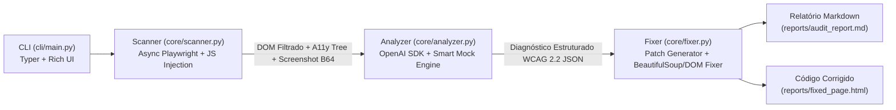

# System Design & Architecture — Accessibility Radar

**Projeto:** Accessibility Radar  
**Hackathon:** Kiroween  
**Arquitetura:** Pipeline Assíncrono Modular (Scanner -> Multimodal AI Analyzer -> Surgical Auto-Fixer -> Rich CLI)

---

## 1. Visão Arquitetural de Alto Nível

O **Accessibility Radar** opera em uma arquitetura de 4 camadas desacopladas que transformam uma página web renderizada (URL ou arquivo local) em diagnósticos WCAG 2.2 acionáveis e patches automáticos de código:



---

## 2. Detalhamento dos Módulos (`core/` e `cli/`)

### 2.1. `core/scanner.py` — Motor de Coleta Multimodal e Filtragem In-Browser
Responsável por renderizar a página em um navegador real (Chromium via `playwright.async_api`) e extrair apenas os sinais necessários para os 4 pilares, evitando enviar árvores HTML inteiras para a LLM.

1. **Resolução de Alvo (`_resolve_target_url`):**
   - Aceita URLs remotas (`https://...`, `http://...`) ou arquivos locais (`tests/broken_page.html`), convertendo caminhos locais automaticamente em URIs `file:///...` absolutas via `pathlib.Path.resolve().as_uri()`.
2. **Captura Visual (`page.screenshot`):**
   - Aguarda `wait_until="networkidle"` e captura o screenshot de página inteira (`full_page=True`), codificando-o em Base64 para envio ao modelo Vision (`AI_MODEL_VISION`) e salvando uma cópia em `reports/latest_screenshot.png`.
3. **Extração da Árvore de Acessibilidade (`_extract_accessibility_tree`):**
   - Tenta primariamente `await page.accessibility.snapshot()`.
   - Caso a versão instalada do Playwright tenha descontinuado `page.accessibility` (Playwright $\ge 1.49$), utiliza automaticamente uma sessão CDP (`Accessibility.getFullAXTree`) para reconstruir a árvore semântica de nós acessíveis (`role`, `name`, `value`, `focused`, `description`).
4. **Injeção de JavaScript Cirúrgica (`A11Y_EXTRACTION_JS`):**
   - Executa dentro do navegador para inspecionar elementos vivos e retornar 4 coleções enxutas:
     - `contrast_candidates`: Calcula em tempo de execução a luminância relativa WCAG 2.x subindo na árvore ancestral para resolver fundos transparentes (`rgba(0,0,0,0)`), retornando `foreground_hex`, `background_hex`, `contrast_ratio`, `required_ratio` (`4.5` para texto normal, `3.0` para texto grande) e status de aprovação.
     - `interactive_candidates`: Avalia `<button>`, `<a>`, `<input>`, `<select>`, `<textarea>` e `[role="button"]`, verificando texto visível, `aria-label`, `aria-labelledby`, `title`, `placeholder` e `<label for="id">` associado.
     - `media_candidates`: Inspeciona `` e `<svg>`, capturando `alt`, `role`, `<title>`, contexto textual do container pai (ex.: título do card de produto vizinho) e flag de descrição genérica (`imagem`, `foto`, `banner`, `image`, `photo`, `icon`).
     - `focus_keyboard_candidates`: Detecta `tabindex > 0`, elementos com `outline: none` / `0px` sem `box-shadow` compensatório, elementos não-nativos clicáveis (`div[onclick]`, `span[onclick]`) sem `tabindex`/`role`, e handlers `onkeydown` que bloqueiam `Tab` ou `Escape`.

---

### 2.2. `core/analyzer.py` — Cliente de IA Multimodal & Smart Fallback
Responsável por transformar os dados brutos do scanner em um relatório estruturado de conformidade WCAG 2.1/2.2 (Nível A e AA).

1. **Cliente Flexível (`OpenAI` SDK):**
   - Configurado via `.env` com:
     - `AI_BASE_URL` (ex.: `https://openrouter.ai/api/v1`, `https://api.openai.com/v1`, `https://api.x.ai/v1`, `http://localhost:11434/v1`)
     - `AI_API_KEY`
     - `AI_MODEL_TEXT`
     - `AI_MODEL_VISION`
   - Envia um prompt de sistema especialista em WCAG 2.2 exigindo saída JSON estruturada com os problemas detectados, critérios WCAG violados, impacto no usuário de tecnologias assistivas (NVDA, VoiceOver, navegação por teclado) e código corrigido.
2. **Modo Mock/Fallback Inteligente (`_analyze_with_smart_fallback`):**
   - Caso `AI_API_KEY` esteja vazia, com valor de exemplo (`your_api_key_here`), ou o usuário passe `--mock`, o analisador executa um motor determinístico sobre o JSON real extraído pelo `scanner.py`.
   - Para **Contraste**, calcula automaticamente uma cor hexadecimal acessível que atinge razão $\ge 4.5:1$ (ou $\ge 7.0:1$ AAA) mantendo a identidade cromática original.
   - Para **Elementos Mudos**, infere o rótulo semântico (`aria-label`) a partir de ícones internos, classes CSS, atributos `name`/`id`/`placeholder` ou contexto do componente pai.
   - Para **Semântica de Mídia**, sintetiza descrições `alt` ricas baseadas nos títulos/preços do card pai e nome do arquivo da imagem.
   - Para **Ordem de Foco e Teclado**, normaliza `tabindex="0"`, remove bloqueios de `Tab`/`Escape` e restaura indicadores `:focus-visible`.

---

### 2.3. `core/fixer.py` — Gerador de Patches e Auto-Remediação DOM
Responsável por converter o diagnóstico do `analyzer.py` em relatórios auditáveis e aplicar correções diretamente em arquivos locais.

1. **Geração de Patches Unificados (`generate_patches`):**
   - Cria diffs formatados comparando `original_code` e `fixed_code` para cada violação dos 4 pilares.
2. **Aplicação Cirúrgica em Arquivo Local (`apply_fixes_to_file`):**
   - Utiliza `BeautifulSoup` (`html.parser`) combinado com substituição exata de snippets e injeção de folha de estilo corretiva (`#accessibility-radar-fixes`) para:
     - Corrigir cores de baixo contraste inline e em classes CSS;
     - Adicionar `aria-label` e `<label>` em controles interativos mudos;
     - Substituir ou adicionar atributos `alt` contextuais e `role="img"` em SVGs;
     - Corrigir `tabindex > 0` para `tabindex="0"`, adicionar suporte de teclado em `div[onclick]`, remover armadilhas de teclado e garantir `:focus-visible` de alto contraste.
3. **Exportação de Relatório (`generate_markdown_report`):**
   - Gera `reports/audit_report.md` com:
     - Scorecard de Acessibilidade (0 a 100) e selo de conformidade WCAG 2.2;
     - Resumo executivo por Pilar e por Severidade (`critical`, `serious`, `moderate`, `minor`);
     - Tabela detalhada de violações;
     - Blocos comparativos **Antes vs. Depois** (`html` / `css`) prontos para copiar ou aplicar.

---

### 2.4. `cli/main.py` — Interface Rich CLI
Construída com `typer` e `rich`, oferecendo três comandos principais:
- `python -m cli.main scan <url_or_path>`: Executa o scanner e o analyzer, renderiza o dashboard no terminal e salva `reports/audit_report.md`.
- `python -m cli.main fix <file_path>`: Executa a auditoria, exibe os patches de código lado a lado e aplica as correções no arquivo local (ou gera arquivo corrigido).
- `python -m cli.main demo`: Executa a demonstração completa na página `tests/broken_page.html`, gera `reports/audit_report.md` e `reports/fixed_page.html`, e realiza uma re-auditoria de verificação comprovando a correção de todas as falhas.

---

## 3. Modelo de Dados do Diagnóstico (JSON Schema)

```json
{
  "target": "tests/broken_page.html",
  "timestamp": "2026-11-02T16:45:00Z",
  "mode": "ai_multimodal | smart_fallback",
  "summary": {
    "score": 32,
    "wcag_status": "Não Conforme (WCAG 2.2 AA)",
    "total_issues": 14,
    "by_pillar": {
      "contrast_visibility": 3,
      "muted_interactives": 4,
      "media_semantics": 3,
      "focus_keyboard": 4
    },
    "by_severity": {
      "critical": 6,
      "serious": 6,
      "moderate": 2,
      "minor": 0
    }
  },
  "issues": [
    {
      "id": "A11Y-001",
      "pillar": "contrast_visibility",
      "pillar_label": "1. Contraste e Visibilidade",
      "wcag_criterion": "1.4.3 Contrast (Minimum)",
      "wcag_level": "AA",
      "severity": "serious",
      "selector": ".promo-banner-text",
      "title": "Contraste insuficiente entre texto e plano de fundo (1.89:1)",
      "description": "O texto possui cor #b8bcc4 sobre fundo #f8f9fa, resultando em razão de contraste 1.89:1 (mínimo exigido: 4.5:1).",
      "impact": "Usuários com baixa visão, daltonismo ou em ambientes muito iluminados não conseguem ler o cupom promocional.",
      "original_code": "<p class=\"promo-banner-text\">Use o cupom KIROWEEN50 para 50% OFF</p>",
      "fixed_code": "<p class=\"promo-banner-text\" style=\"color: #2d3748; background-color: #f8f9fa;\">Use o cupom KIROWEEN50 para 50% OFF</p>",
      "remediation_notes": "Ajustar a cor do texto para #2d3748 (contraste 11.4:1 sobre #f8f9fa)."
    }
  ]
}
```
