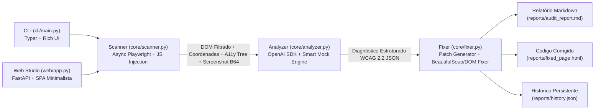

# System Design & Architecture — Accessibility Radar

**Projeto:** Accessibility Radar  
**Hackathon:** Kiroween  
**Metodologia:** Kiro Spec-Driven Development (`.kiro/specs/accessibility-radar/`)  
**Arquitetura:** Pipeline Assíncrono Modular (Scanner -> Multimodal AI Analyzer -> Surgical Auto-Fixer -> Rich CLI & FastAPI Web Studio)

---

## 1. Visão Arquitetural de Alto Nível

O **Accessibility Radar** opera em uma arquitetura modular que transforma qualquer página web renderizada (URL remota, arquivo local ou HTML bruto) em diagnósticos WCAG 2.2 acionáveis, mapas visuais de foco/hotspots e patches automáticos de código, acessíveis tanto via **CLI (Typer + Rich)** quanto via **Interface Gráfica Web Moderna (`web/app.py` + SPA)**:



---

## 2. Detalhamento dos Módulos (`core/`, `cli/` e `web/`)

### 2.1. `core/scanner.py` — Motor de Coleta Multimodal e Filtragem In-Browser
Responsável por renderizar a página em um navegador real (Chromium via `playwright.async_api`) nos perfis de viewport `desktop` (`1280×900`), `tablet` (`768×1024`) ou `mobile` (`390×844`), extraindo apenas os sinais necessários para os 5 pilares e mapeando coordenadas visuais:

1. **Resolução Inteligente de Alvo (`resolve_target_url`):**
   - Aceita URLs completas (`https://...`, `http://...`), domínios diretos sem protocolo (`example.com`, `localhost:3000`) ou arquivos locais (`tests/broken_page.html`).
   - Para sites remotos, salva automaticamente um snapshot do DOM renderizado (`reports/remote_snapshot.html` com `<base href>`) para viabilizar auto-correção e preview comparativo também em páginas externas.
2. **Captura Visual (`page.screenshot`):**
   - Aguarda `wait_until="networkidle"` (com fallback resiliente para `domcontentloaded` em portais pesados) e captura o screenshot de página inteira (`full_page=True`), salvando `before_screenshot.png` / `after_screenshot.png` e `latest_screenshot.png`.
3. **Extração da Árvore de Acessibilidade (`_extract_accessibility_tree`):**
   - Tenta primariamente `await page.accessibility.snapshot()` e realiza fallback automático via sessão CDP (`Accessibility.getFullAXTree`) para reconstruir a árvore semântica de nós acessíveis (`role`, `name`, `description`, `focusable`).
4. **Injeção de JavaScript Cirúrgica (`A11Y_DOM_FILTER_JS`):**
   - Executa dentro do navegador para extrair:
     - `contrast_visibility`: Luminância relativa W3C subindo na árvore ancestral para resolver fundos transparentes, razão de contraste e `rect` (`x, y, width, height`).
     - `muted_interactives`: Controles `<button>`, `<a>`, `<input>`, `<select>`, `<textarea>` sem nome acessível calculado.
     - `media_semantics`: Elementos `` e `<svg>` sem `alt`/`title`/`role="img"` ou com descrições genéricas.
     - `focus_keyboard`: Uso de `tabindex > 0`, supressão de `:focus-visible` (`outline: none`), `div[onclick]` sem suporte a teclado e *keyboard traps* em `onkeydown`.
     - `semantic_structure`: Ausência de `html[lang]`, ausência de `<title>` e saltos na hierarquia de cabeçalhos `H1–H6`.
     - `focus_order_map` & `document_outline`: Sequência real numerada de foco da tecla `Tab` com coordenadas visuais e árvore de cabeçalhos + ARIA Landmarks.

---

### 2.2. `core/analyzer.py` — Cliente de IA Multimodal & Smart Fallback
Responsável por transformar os dados brutos do scanner em um relatório estruturado de conformidade WCAG 2.1/2.2 (Nível A e AA) nos 5 pilares:

1. **Cliente Flexível (`OpenAI` SDK):**
   - Configurado via `.env` (`AI_BASE_URL`, `AI_API_KEY`, `AI_MODEL_TEXT`, `AI_MODEL_VISION`), compatível com OpenRouter, OpenAI, Grok, Gemini e Ollama.
2. **Modo Mock/Fallback Inteligente (`_analyze_with_smart_fallback`):**
   - Processa o JSON real extraído pelo `scanner.py` sem necessidade de chave de API, calculando cores de alto contraste ($\ge 4.5:1$ AA / $\ge 7.0:1$ AAA), inferindo `aria-label` semânticos, sintetizando descrições `alt` contextuais e corrigindo fluxo de foco e semântica estrutural.

---

### 2.3. `core/fixer.py` — Gerador de Patches Seletivo, Auto-Remediação DOM e Histórico
Responsável por converter o diagnóstico do `analyzer.py` em relatórios auditáveis, aplicar correções cirúrgicas e manter o histórico:

1. **Geração de Diffs Unificados (`generate_unified_diff`):**
   - Constrói diffs comparando `original_code` e `fixed_code` para cada violação.
2. **Aplicação Cirúrgica e Seletiva (`apply_fixes_to_file`):**
   - Suporta aplicação total ou granular (`selected_issue_ids`) com edição customizada de atributos (`custom_overrides`) usando `BeautifulSoup` (`html.parser`) e injeção de folha de estilo corretiva (`#accessibility-radar-remediation`).
3. **Relatórios e Histórico (`generate_markdown_report` & `record_audit_history`):**
   - Gera `reports/audit_report.md` e registra cada execução e evolução de score em `reports/history.json`.

---

### 2.4. `cli/main.py` — Interface Rich CLI
Construída com `typer` e `rich`, oferecendo quatro comandos principais:
- `python -m cli.main ui`: Inicia o servidor da Interface Gráfica Web (FastAPI + Uvicorn) com detecção automática de porta livre.
- `python -m cli.main scan <url_or_path>`: Executa o scanner e o analyzer, renderiza o dashboard dos 5 pilares no terminal e salva `reports/audit_report.md`.
- `python -m cli.main fix <file_path>`: Executa a auditoria, exibe os patches de código e aplica as correções no arquivo local.
- `python -m cli.main demo`: Executa a demonstração completa na página `tests/broken_page.html`, gera `reports/audit_report.md` e `reports/fixed_page.html`, e realiza a re-auditoria comprovando o Score `100/100`.

---

### 2.5. `web/app.py` & `web/static/` — Interface Gráfica Web Minimalista (Web Studio)
Construída com **FastAPI** no backend e uma **SPA Minimalista em HTML5/CSS3/JS** no frontend (com suporte a Light/Dark Mode e conformidade WCAG 2.2):
- **Endpoints REST (`web/app.py`):**
  - `GET /api/state`: Carrega o estado atual, último diagnóstico, verificação pós-fix, relatório Markdown, histórico e configurações.
  - `POST /api/scan`: Executa auditoria em URL remota, arquivo local ou HTML bruto (Playground) no viewport escolhido.
  - `POST /api/fix`: Aplica correções selecionadas (`selected_issue_ids` + `custom_overrides`) e re-audita automaticamente a página corrigida.
  - `POST /api/demo`: Executa o ciclo fechado completo (`broken_page.html` $\rightarrow$ `fixed_page.html`) retornando dados Antes vs. Depois.
  - `POST /api/contrast-check` & `GET/POST /api/settings`: Calculadora de contraste W3C e gerenciamento do `.env`.

---

## 3. Modelo de Dados do Diagnóstico (JSON Schema v2.0)

```json
{
  "target": "tests/broken_page.html",
  "viewport": "desktop",
  "viewport_dimensions": { "width": 1280, "height": 900 },
  "page_dimensions": { "width": 1280, "height": 1420, "viewport_width": 1280, "viewport_height": 900 },
  "timestamp": "2026-11-10T02:00:00Z",
  "mode": "ai_multimodal | smart_fallback",
  "summary": {
    "score": 0,
    "wcag_status": "Não Conforme (Violações Críticas WCAG 2.2 A/AA)",
    "total_issues": 18,
    "by_pillar": {
      "contrast_visibility": 3,
      "muted_interactives": 4,
      "media_semantics": 5,
      "focus_keyboard": 6,
      "semantic_structure": 0
    },
    "by_severity": {
      "critical": 11,
      "serious": 7,
      "moderate": 0,
      "minor": 0
    }
  },
  "document_outline": {
    "headings": [{ "level": 1, "tag": "h1", "text": "Setup Gamer Assustadoramente Rápido", "selector": "h1", "skipped": false }],
    "landmarks": [{ "role": "banner", "tag": "header", "selector": "header" }]
  },
  "focus_order_map": [
    {
      "order": 1,
      "selector": "#nav-deals-link",
      "tag": "a",
      "label": "Ofertas Kiroween",
      "tabindex": 5,
      "has_positive_tabindex": true,
      "missing_focus_ring": true,
      "rect": { "x": 920, "y": 58, "width": 118, "height": 24 }
    }
  ],
  "issues": [
    {
      "id": "A11Y-001",
      "pillar": "contrast_visibility",
      "pillar_label": "1. Contraste e Visibilidade",
      "wcag_criterion": "1.4.3 Contrast (Minimum)",
      "wcag_level": "AA",
      "severity": "critical",
      "selector": "#promo-coupon-banner",
      "rect": { "x": 0, "y": 0, "width": 1280, "height": 42 },
      "title": "Contraste insuficiente de texto (1.9:1 vs mínimo 4.5:1)",
      "original_code": "<div id=\"promo-coupon-banner\" class=\"promo-coupon-bar\">...</div>",
      "fixed_code": "<div style=\"color: #1a202c; background-color: #f8fafc;\" id=\"promo-coupon-banner\" class=\"promo-coupon-bar\">...</div>",
      "remediation_notes": "Alterar a cor do texto para #1a202c sobre #f8fafc, elevando o contraste para 15.6:1 (WCAG AAA)."
    }
  ]
}
```
