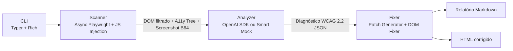

# 🎃 Accessibility Radar

### Autonomous Web Accessibility Auditor & Auto-Fixer (WCAG 2.2)

> De páginas inacessíveis a código conforme com a **WCAG 2.2** em segundos — alimentado por **Playwright Headless**, **Accessibility Tree** real, **Visão Computacional Multimodal** e **Spec-Driven Development**.

<p>
  
  
  
  
  
</p>

O **Accessibility Radar** é um agente autônomo de ciclo fechado que abre uma página em um navegador real, extrai a *Accessibility Tree* e os estilos computados, analisa o screenshot de forma multimodal e **gera + aplica automaticamente** patches de código (HTML/CSS/JSX), revalidando a página até atingir conformidade.

> **Submissão Oficial para o Hackathon Kiroween**

---

## 📑 Índice

- [Por que existe](#-por-que-existe)
- [Os 5 Pilares de Auditoria](#-os-5-pilares-de-auditoria-wcag-22-a--aa)
- [Como funciona](#️-como-funciona-pipeline)
- [Instalação](#-instalação)
- [Configuração de IA (opcional)](#-configuração-de-ia-opcional)
- [Uso da Interface Web & CLI](#-uso-da-interface-web--cli)
- [Exemplo de resultado](#-exemplo-de-resultado-demo)
- [Estrutura do projeto](#-estrutura-do-projeto)
- [Solução de problemas](#-solução-de-problemas)
- [FAQ](#-faq)
- [Tecnologias](#-tecnologias)
- [Contribuindo](#-contribuindo)
- [Licença](#-licença)

---

## 💡 Por que existe

Segundo o estudo **WebAIM Million**, mais de **96% das páginas web** falham em critérios básicos da WCAG. As ferramentas tradicionais sofrem de três limitações:

1. **São cegas ao navegador real** — analisam HTML bruto sem calcular estilos CSS herdados, transparências, estados renderizados por JS ou a *Accessibility Tree* exposta a leitores de tela (NVDA, VoiceOver, JAWS).
2. **Não enxergam contexto visual** — sabem dizer se um `alt` existe, mas não detectam que `alt="imagem"` é inútil nem geram uma descrição precisa.
3. **Apontam erros, mas não consertam** — o desenvolvedor recebe uma lista de alertas sem o patch pronto.

O Accessibility Radar fecha esse ciclo: **detecta, explica, corrige e revalida**.

---

## 🎯 Os 5 Pilares de Auditoria (WCAG 2.2 A & AA)

| Pilar | Critérios WCAG | Detecção & Correção |
| :--- | :--- | :--- |
| **1. Contraste e Visibilidade** | `1.4.3 (AA)` · `1.4.11 (AA)` | Coleta `color`/`backgroundColor` computados (resolvendo fundos transparentes na árvore ancestral), calcula a luminância relativa oficial da W3C e aplica cores com razão ≥ 4.5:1 (ou ≥ 7:1 AAA). |
| **2. Elementos Interativos Mudos** | `4.1.2 (A)` · `2.4.4 (A)` · `1.3.1 (A)` | Identifica `button`, `a`, `input`, `select` sem nome acessível na Accessibility Tree e injeta `aria-label`/`<label>` semânticos a partir do ícone/contexto. |
| **3. Semântica de Mídia** | `1.1.1 (A)` | Detecta `img`/`svg` sem `alt`, com `alt=""` indevido ou descrições genéricas e sintetiza descrições contextuais. |
| **4. Ordem de Foco e Teclado** | `2.4.3 (A)` · `2.4.7 (AA)` · `2.1.1 (A)` · `2.1.2 (A)` | Corrige `tabindex > 0`, restaura `:focus-visible` suprimido por `outline: none`, torna `div[onclick]` acessível por teclado e remove *keyboard traps*. |
| **5. Estrutura e Semântica** | `3.1.1 (A)` · `2.4.2 (A)` · `1.3.1 (A)` · `2.4.6 (AA)` | Audita atributo `lang` no `<html>`, `<title>`, landmarks (`<main>`, `<nav>`, `<header>`), hierarquia de cabeçalhos (`<h1>`–`<h6>`) e mecanismo *Skip to Content*. |

---

## ⚙️ Como funciona (pipeline)



1. **Scanner** renderiza a página no Chromium headless, captura screenshot full-page, extrai a Accessibility Tree e injeta JS que filtra cirurgicamente só os elementos relevantes aos 4 pilares (economiza >80% de tokens).
2. **Analyzer** envia os dados a um provedor compatível com OpenAI (Vision) **ou** ativa o **Smart Mock/Fallback** determinístico quando não há chave de API.
3. **Fixer** gera diffs "Antes/Depois", aplica correções com BeautifulSoup e exporta o relatório Markdown.

---

## 🚀 Instalação

### Pré-requisitos
- **Python 3.10 ou superior**

### Passo a passo

```bash
# 1. Crie e ative um ambiente virtual
python -m venv venv

# Windows (PowerShell):
.\venv\Scripts\Activate.ps1
# Linux/macOS:
# source venv/bin/activate

# 2. Instale as dependências
pip install -r requirements.txt

# 3. Instale o navegador headless do Playwright
playwright install chromium
```

> 💡 Se o `playwright install chromium` falhar, o agente faz **fallback automático** para o Google Chrome ou Microsoft Edge já instalados no sistema.

---

## 🔑 Configuração de IA (opcional)

O agente funciona **100% sem chave de API** graças ao **Smart Mock/Fallback**, que processa os dados reais extraídos pelo Playwright com heurísticas determinísticas. Para usar IA multimodal (Vision), copie o template e preencha o `.env`:

```bash
# Windows
copy .env.example .env
# Linux/macOS
cp .env.example .env
```

```env
AI_BASE_URL=https://openrouter.ai/api/v1
AI_API_KEY=sua_chave_aqui
AI_MODEL_TEXT=openai/gpt-4o-mini
AI_MODEL_VISION=openai/gpt-4o-mini
```

Compatível com qualquer endpoint no padrão OpenAI: **OpenRouter**, **OpenAI**, **xAI (Grok)**, **Gemini (OpenAI-compat)** e **Ollama** (`http://localhost:11434/v1`).

> ⚠️ **Nunca** compartilhe seu arquivo `.env` publicamente.

Detalhes em [`docs/CONFIGURATION.md`](./docs/CONFIGURATION.md).

---

## 💻 Uso da Interface Web & CLI

O projeto oferece tanto uma **Interface Web Moderna e Minimalista** (FastAPI + SPA com Light/Dark Mode) quanto uma **CLI interativa**. A flag `--mock` força o modo determinístico (sem consumir créditos de API).

### `ui` — Interface Web Completa (Web Studio)
Inicia o painel visual interativo com Scorecard, Inspetor de Hotspots no Screenshot, Mapa de Ordem de Foco (`Tab`), Simulador de Daltonismo/Baixa Visão, Auto-Fixer Seletivo com Live Preview Lado a Lado, Explorador da Accessibility Tree, Simulador de Leitor de Tela e Calculadora de Contraste W3C:

```bash
python -m cli.main ui
```

### `demo` — ciclo completo de demonstração
Escaneia `tests/broken_page.html`, gera o relatório, cria a página corrigida e **re-audita** para comprovar a evolução do score.

```bash
python -m cli.main demo
python -m cli.main demo --mock
```

### `scan` — auditar uma URL ou arquivo local
```bash
python -m cli.main scan tests/broken_page.html
python -m cli.main scan https://example.com
python -m cli.main scan https://example.com --output meu_relatorio.md
```

### `fix` — gerar e aplicar correções
```bash
# Gera a versão corrigida em reports/fixed_page.html
python -m cli.main fix tests/broken_page.html

# Aplica direto no arquivo original (cria backup .bak automaticamente)
python -m cli.main fix tests/broken_page.html --in-place
```

Guia completo em [`docs/USAGE.md`](./docs/USAGE.md).

---

## 📊 Exemplo de resultado (`demo`)

| Métrica | Antes (`broken_page.html`) | Depois (`fixed_page.html`) |
| :--- | :---: | :---: |
| **Score de Acessibilidade** | `0 / 100` | **`100 / 100`** |
| Contraste e Visibilidade | 3 falhas | **0 falhas** |
| Elementos Interativos Mudos | 5 falhas | **0 falhas** |
| Semântica de Mídia | 5 falhas | **0 falhas** |
| Ordem de Foco e Teclado | 6 falhas | **0 falhas** |
| **Status WCAG 2.2 AA** | ❌ Não Conforme | ✅ **Conforme** |

Saídas geradas em `reports/`: `audit_report.md`, `audit_results.json`, `fixed_page.html` e `latest_screenshot.png`.

---

## 📁 Estrutura do projeto

```text
accessibility-radar/
├── .kiro/specs/accessibility-radar/  # Especificações Kiro (Spec-Driven Development)
├── core/
│   ├── scanner.py                # Async Playwright + Screenshot + Accessibility Tree + JS DOM Filter
│   ├── analyzer.py               # Cliente OpenAI SDK + Motor Smart Mock/Fallback
│   └── fixer.py                  # Diffs Antes/Depois, Auto-Fixer DOM e Relatório Markdown
├── cli/
│   └── main.py                   # CLI interativa (Typer + Rich): ui, scan, fix, demo
├── web/
│   ├── app.py                    # Servidor FastAPI (REST API + Web Studio)
│   └── static/                   # SPA moderna (index.html, styles.css, app.js)
├── tests/
│   └── broken_page.html          # Mini e-commerce com falhas intencionais nos 4 pilares
├── docs/
│   ├── USAGE.md                  # Guia detalhado de uso
│   ├── CONFIGURATION.md          # Configuração de provedores de IA
│   └── TROUBLESHOOTING.md        # Erros comuns e soluções
├── reports/                      # Saídas geradas
├── requirements.md               # Requisitos (EARS + WCAG 2.2)
├── design.md                     # Arquitetura técnica
├── tasks.md                      # Checklist de implementação
├── .env.example                  # Template de configuração de IA
├── requirements.txt              # Dependências Python
├── CONTRIBUTING.md               # Como contribuir
├── CHANGELOG.md                  # Histórico de versões
├── LICENSE                       # MIT
└── README.md
```

---

## 🔧 Solução de problemas

| Sintoma | Solução |
| :--- | :--- |
| `playwright: command not found` | Ative o venv e rode `pip install -r requirements.txt`. |
| Erro ao iniciar o Chromium | Rode `playwright install chromium` ou garanta Chrome/Edge instalados. |
| Caracteres estranhos no terminal (Windows) | É só a renderização de caixas do Rich; não afeta o resultado. Use Windows Terminal para melhor exibição. |
| `ModuleNotFoundError` | Confirme que o venv está ativo antes de rodar os comandos. |

Mais detalhes em [`docs/TROUBLESHOOTING.md`](./docs/TROUBLESHOOTING.md).

---

## ❓ FAQ

**Preciso de uma chave de API para testar?**
Não. Sem chave, o Smart Mock/Fallback processa os dados reais do navegador e gera correções completas.

**Funciona offline?**
Sim, no modo mock e em arquivos HTML locais. URLs remotas exigem internet para carregar a página.

**Suporta frameworks (React/Vue/Angular)?**
O scan funciona sobre o DOM renderizado, então captura o resultado final. A aplicação automática de patches (`fix`) é otimizada para arquivos HTML; para JSX, use os diffs do relatório como guia.

**É um substituto para auditoria manual?**
Não. A conformidade total com a WCAG exige testes com tecnologias assistivas e revisão de especialistas. A ferramenta acelera e automatiza a maior parte do trabalho, mas o julgamento humano continua necessário.

---

## 🛠️ Tecnologias

- **Python 3.10+**
- **Playwright (Async API)** — renderização real, CSS computado, screenshot full-page e Accessibility Tree.
- **OpenAI Python SDK** — compatível com OpenRouter, OpenAI, Grok, Gemini e Ollama via `AI_BASE_URL`.
- **BeautifulSoup4** — manipulação cirúrgica do DOM.
- **Typer & Rich** — CLI moderna com tabelas, spinners e syntax highlighting.

---

## 🤝 Contribuindo

Contribuições são bem-vindas! Leia o [`CONTRIBUTING.md`](./CONTRIBUTING.md) para o fluxo de trabalho e padrões de código.

---

## 📄 Licença

Distribuído sob a licença **MIT**. Veja [`LICENSE`](./LICENSE) para os termos completos.
